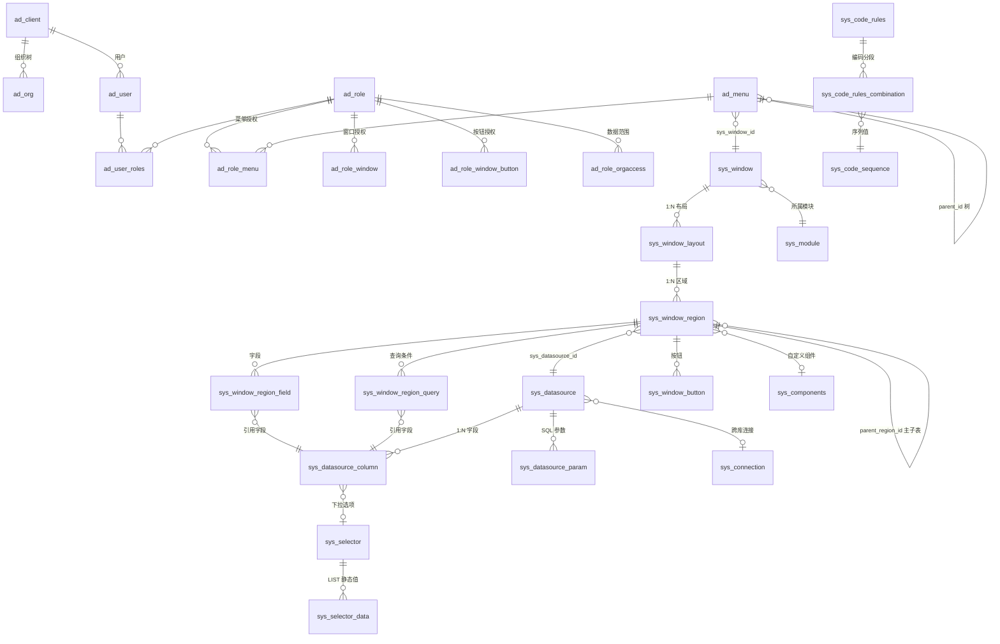
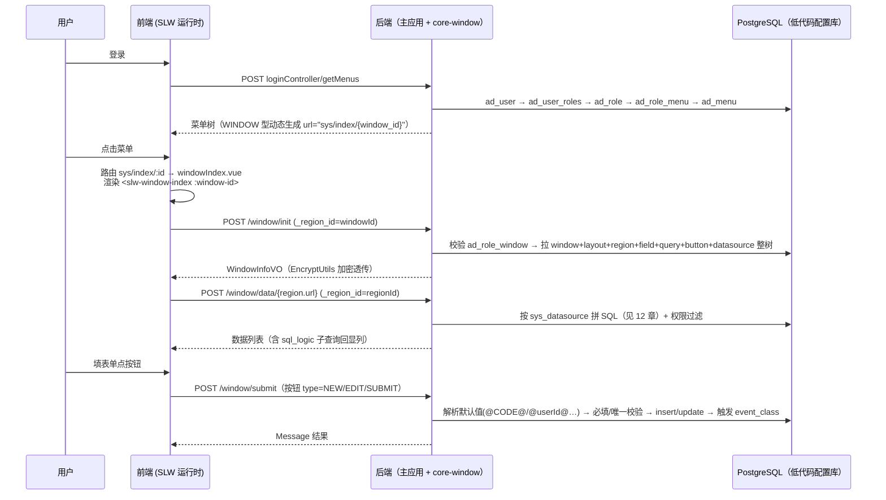
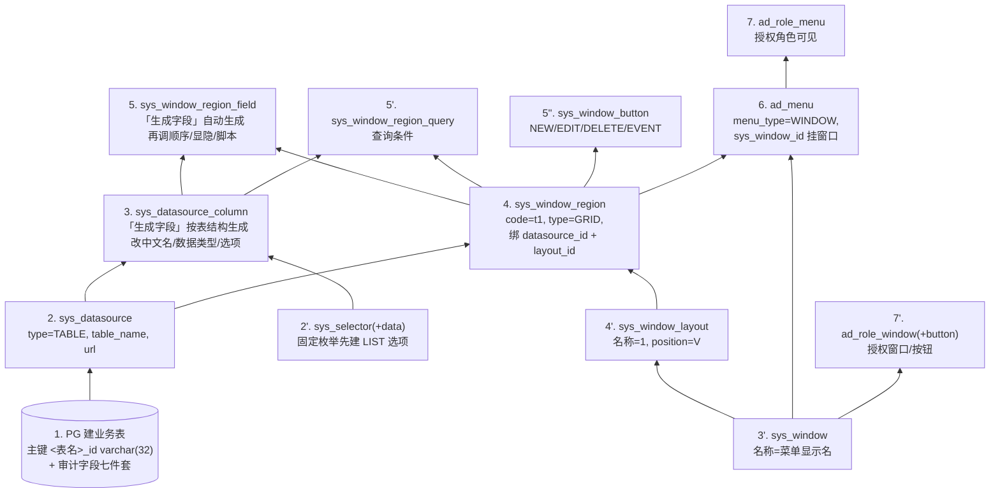
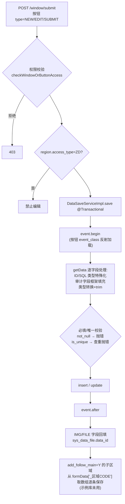
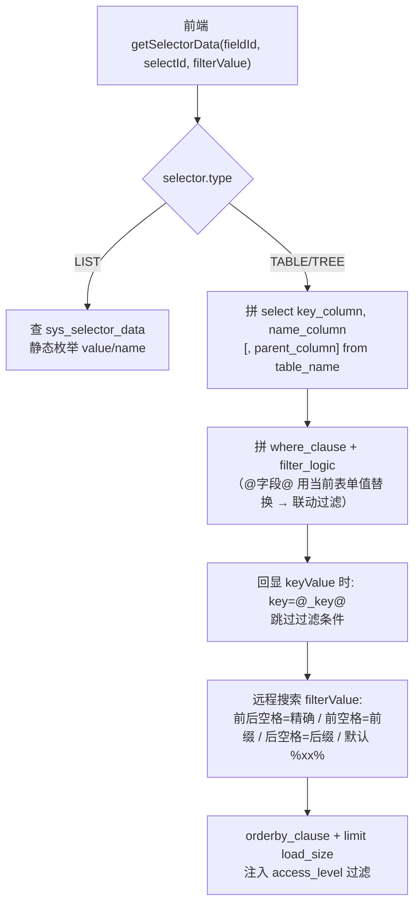
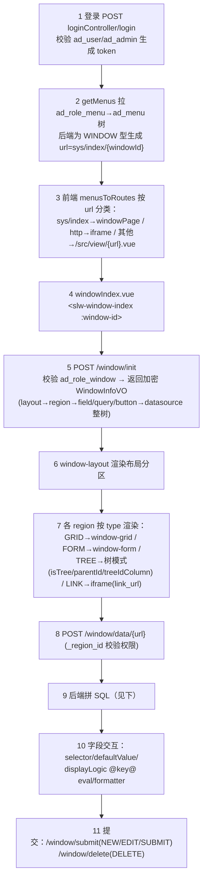

# 低代码平台配置与对象关系

> 📌 **本项目适用性注记（{{项目名}}，{{YYYY-MM-DD}} 由 project-agent-init 安装，安装后须按实际改写）**：本文档为 SLW/core-window 低代码平台的通用配置文档。安装时须确认三点——①**版本**：本项目后端引擎 core-window **{{版本}}**、前端运行时 `slw {{版本}}`（文档正文基于 3.2.0 整理，4.x 差异见下方「4.0.0 勘误表」）；②**租户过滤**：本项目 `system.close-client-filter` = {{true 已关闭 / 未关闭}}——已关闭则文中「SQL 数据源必须写 `[accessLevel]`」的约束不适用；③**数据库方言**：本项目目标库为 {{PostgreSQL / 达梦 DM8 / ...}}——非 PG 库（如信创达梦）须将本文件与插库脚本中的 PG 方言 SQL 转译后使用；④文中的配置规模与样本数字来自示例库实测，本项目规模不同。
>
> **4.0.0 勘误表（对照 core-window 主线 4.0.0 源码核对，正文未逐章改写，遇下列主题以本表为准）**：
>
> | # | 涉及章节 | 勘误（4.0.0 实际） |
> | --- | --- | --- |
> | E1 | 第 10 章 APP 设计器 | `sys_app_design` 已删除；改为全新 `com.core.app` 包 8 张表：sys_app / sys_app_button / sys_app_panel / sys_app_panel_field / sys_app_panel_query / sys_page / sys_page_component / sys_page_field；APP 菜单 url=`appView/{menu.app_id}` |
> | E2 | 7.1 sys_window | 实体无 version 字段；窗口版本存独立表 `Sys_Window_Version` 并支持版本回滚 |
> | E3 | 7.3 sys_window_region | 实体不再映射 parent_key_column / font_size / sync_delete_sub_data（font_size 已删；前两者仍在 Bo/VO 经 SQL 读写，功能未删）；**新增列** sys_module_id、toolbar_position_right、show_title |
> | E4 | 8.1 sys_datasource | is_summary 列已删（全库零命中） |
> | E5 | 7.6 sys_window_button | pic_multiple / pic_format 列已删 |
> | E6 | sys_selector_data | 新增可空列 group_code（Selector 实体归属从 core-window 移到 api-service，表结构未变） |
> | E7 | 8.8 编码规则 | sys_code_sequence 的 date 列改名 **code_date**（新增 counter_self）；分段类型**无 SQL 型**（仅 SELF/日期/PARAM/ORG/XL 等，CodeRulesUtil.java:18-28）；sys_code_rules 新增 SAVE_SELF_MAX / SAVE_ORG_MAX / IS_SELF / IS_DATE 特性 |
> | E8 | 5.1 / 13 章接口 | `/window/init` 参数为 `id`（非 `_region_id`）；`/window/data/{url}` 支持 1–3 级路径（/data/\*、/data/\*/\*、/data/\*/\*/\*） |
> | E9 | 13 章接口 | 新增：/window/export+import（数据级导出导入，区别于 exportWindow 配置级）、/window/paramsDefaultValue（查询默认值）、/dataLock（Redis 数据锁）、/dbConnection/testConnection、/dbTableColumn/generateTableStructure（数据源反向建表）、windowButton/rollbackWindow |
> | E10 | 第 6 章语法表 | 新增 `@orgName@`（⚠️ 实现可疑：返回的是 orgId 而非组织名，勿依赖）；占位符支持大小写变体；查询默认值新增 MONTH 类型与 `\|` 范围解析；/datasource 通用取数也支持 @SQL= 等默认值。既有语法（@CODE@/@SQL=/[accessLevel]/event_class 等）全部保留 |
> | E11 | 第 9 章权限 | 窗口权限校验改为**登录时缓存**（登录装载 RoleWindow/RoleWindowButton/RoleWindowRegion 于 api-common-util，运行时不再直查 ad_role_*，SYSTEM_CLIENT_ID 用户跳过窗口权限）；授权表本身未变 |
> | E12 | 架构级 | 新增 Redis 分布式数据锁、RSALicenseManager 许可证、com.core.generator 代码生成器；区域 type 新增 TREE_STRUCTURE；新表 ad_user_link（api-service） |
> | — | **核心结论** | 菜单→窗口→区域→字段→数据源的核心闭环、全部主链路表名与外键**未变**；`skills/lowcode-page-gen` 插库脚本所用表/列全部兼容，无需改动。⚠️ 勘误基于 4.0.0 实体源码，**目标库物理列未必一致**——首次对目标库执行插入前建议 `\d` 抽查 sys_window_region、sys_code_sequence、sys_selector_data 三表 |
>
> 本文档梳理 SLW 低代码平台（core-window 3.2.0）的配置表结构、对象关系与渲染链路，重点覆盖 **从菜单（ad\_menu）到数据源字段（sys\_datasource\_\*）的完整闭环路径**——生成业务页面时的核心参考。
>
> **数据来源**：示例开发库（PostgreSQL）实测（表结构 `\d` 核对、配置规模与样本均来自真实库数据）；脚本执行时机语义来自 `/Users/wuganglin/code/Common`（core-window / api-service / api-common-util）源码精读。前端配置用法另见 [slw-frontend-config.md](slw-frontend-config.md)（源：官方文档站 slwdoc）。
>
> ⚠️ **命名注意**：菜单表实际名为 **`ad_menu`**（不是 sys\_menu），权限体系整体走 `ad_*` 前缀（iDempiere 风格 AD 元数据模型）；`sys_datasource_*` 属于 core-window 数据源域。两者通过 `ad_menu.sys_window_id → sys_window.sys_window_id` 衔接成闭环。

***

## 目录

- [1. 平台总览](#1-平台总览)

- [2. 配置对象清单与分组](#2-配置对象清单与分组)

- [3. 公共字段（BaseModel）](#3-公共字段basemodel)

- [4. 核心配置对象关系图](#4-核心配置对象关系图)

- [5. 闭环路径：从菜单到数据源字段（页面生成 SOP）](#5-闭环路径从菜单到数据源字段页面生成-sop)

- [6. 脚本字段执行时机（前端 vs 后端）](#6-脚本字段执行时机前端-vs-后端)

- [7. 窗口配置域（core-window）](#7-窗口配置域core-window)

- [8. 数据源域](#8-数据源域)

- [9. 权限模型域（api-service）](#9-权限模型域api-service)

- [10. 系统配置域](#10-系统配置域)

- [11. 打印与消息推送域](#11-打印与消息推送域)

- [12. 配置驱动渲染链路](#12-配置驱动渲染链路)

- [13. 关键后端接口](#13-关键后端接口)

- [14. 前端运行时消费](#14-前端运行时消费)

***

## 1. 平台总览

低代码平台由三部分组成：

| 层          | 实现                                                               | 位置                                                                   |
| ---------- | ---------------------------------------------------------------- | -------------------------------------------------------------------- |
| **后端配置引擎** | `core-window` 3.2.0 jar（`com.forcecon:core-window`）              | `/Users/wuganglin/code/Common/core-window`                           |
| **后端基座**   | `api-service`（用户/权限/租户/系统）+ `api-common-util`（BaseModel/工具/编码规则） | `/Users/wuganglin/code/Common/service/{api-service,api-common-util}` |
| **前端运行时**  | `slw` 私有包（window-index/grid/form/layout/window-designer）         | slwdoc 文档站：`http://slwdoc.js.sforcecon.com:5900/`                    |

**核心理念**：所有管理页面由数据库配置驱动——管理员在"窗口设计器"里配置 **窗口 → 布局 → 区域 → 字段/查询/按钮 → 数据源**，运行时前端拿 `windowId` 调 `/window/init` 拉取整棵配置树渲染页面，数据读写走通用 `/window/data/*` 与 `/window/submit` 接口，无需为每个 CRUD 页面写代码。

**配置即权限**：窗口/按钮的访问通过 `ad_role_window` / `ad_role_window_button` 授权给角色；数据范围通过 `ad_org_id`（组织）+ `ad_client_id`（租户）多租户隔离。

**示例库配置规模实测**（开发库 2026-09-04）：

| 配置对象                       | 记录数   | 说明                                                                           |
| -------------------------- | ----- | ---------------------------------------------------------------------------- |
| sys\_window                | 81    | 页面窗口                                                                         |
| sys\_window\_layout        | \~120 | 布局                                                                           |
| sys\_window\_region        | 155   | 区域（GRID 150 / TREE 2 / FORM 2 / EDIT\_GRID 1）                                |
| sys\_window\_region\_field | 3,162 | 区域字段                                                                         |
| sys\_window\_region\_query | 269   | 查询条件                                                                         |
| sys\_window\_button        | 280   | 按钮（EVENT 95 / EDIT 65 / NEW 58 / DELETE 56 / EXPORT 4 / IMPORT 1 / RELOAD 1） |
| sys\_datasource            | 105   | 数据源（TABLE 100 / SQL 5，无 VIEW 型）                                              |
| sys\_datasource\_column    | 1,973 | 数据源字段                                                                        |
| sys\_selector              | 144   | 数据选项（LIST 106 / TABLE 37 / TREE 1）                                           |
| sys\_selector\_data        | 488   | 静态选项值                                                                        |
| ad\_menu                   | 78    | 菜单（WINDOW 53 / GROUP 17 / SUBPAGE 4 / JOIN 2 / LINK 2）                       |
| sys\_module                | 11    | 模块（见下）                                                                       |
| sys\_code\_rules           | 20    | 自动编码规则（各类业务单号…）                                                                    |
| sys\_connection            | 1     | 数据连接（仅 1 条模板记录，跨库未启用）                                                        |

**sys\_module 模块清单**（11 个，skill 生成配置时 `sys_module_id` 取这些值）：

| sys\_module\_id | name | table\_prefix | package               |
| --------------- | ---- | ------------- | --------------------- |
| MES             | 系统基础 | —             | com.forcecon.basic    |
| MANU            | 生产   | EMESO         | com.forcecon.mes.manu |
| WMS             | WMS  | WMS           | com.forcecon.wms      |
| EAM             | EAM  | EAM           | com.forcecon.eam      |
| QC              | 质量   | EMESQ         | com.forcecon.mes.qc   |
| USER            | 用户权限 | AD            | com.forcecon.user     |
| REPORT          | 报表   | —             | com.forcecon.report   |
| KANBAN          | 看板   | —             | com.forcecon.kanban   |
| EMS             | EMS  | EMS           | com.forcecon.ems      |
| **0**           | 系统模块 | SYS           | com.forcecon.sys      |
| WCS             | WCS  | WCS           | com.forcecon.wcs      |

***

## 2. 配置对象清单与分组

按域分组的全部配置表（示例库 public schema 共 103 张表：sys\_\* 22 / ad\_\* 19 / plug\_\* 14 / 业务表 m\_\*+<业务前缀>\_\* 70 / api\_\* 2）：

### 窗口配置域（core-window，`sys_` 前缀）

| 表名                        | 实体类               | 中文    | 角色                                            |
| ------------------------- | ----------------- | ----- | --------------------------------------------- |
| `sys_window`              | Window            | 窗口    | 页面顶层容器，一个窗口 = 一个页面                            |
| `sys_window_layout`       | WindowLayout      | 布局    | 窗口内的版式分区（位置/宽高/折叠）                            |
| `sys_window_region`       | WindowRegion      | 区域    | 布局区块，绑定数据源+组件，决定渲染形态（表格/表单/树/外链）              |
| `sys_window_region_field` | WindowRegionField | 区域字段  | 表单/表格列定义，绑定数据源字段                              |
| `sys_window_region_query` | WindowRegionQuery | 查询条件  | 表格上方的筛选条件                                     |
| `sys_window_button`       | WindowButton      | 按钮    | 区域/窗口级操作按钮（新增/提交/删除/自定义事件）                    |
| `sys_window_user_column`  | —                 | 用户列偏好 | 用户自定义列（ad\_user\_id + region + show\_columns） |

### 数据源域

| 表名                                                     | 实体类                 | 中文                                                  |
| ------------------------------------------------------ | ------------------- | --------------------------------------------------- |
| `sys_datasource`                                       | SysDataSource       | 数据源（单表/SQL）                                         |
| `sys_datasource_column`                                | SysDataSourceColumn | 数据源字段                                               |
| `sys_datasource_param`                                 | SysDatasourceParam  | SQL 数据源参数                                           |
| `sys_selector`                                         | Selector            | 数据选项（LIST 静态/TABLE 取业务表/TREE 树形）                    |
| `sys_selector_data`                                    | SelectorData        | LIST 型静态选项值                                         |
| `sys_connection`                                       | SysConnection       | 数据库连接（跨库支持，示例库未启用）                                   |
| `sys_components`                                       | SysComponents       | 自定义组件（VUE/ECHARTS）                                  |
| `sys_data_file`                                        | SysDataFile         | 附件文件记录                                              |
| `sys_report_config`                                    | SysReportConfig     | 报表配置                                                |
| `sys_code_rules` (+`_combination`/`sys_code_sequence`) | CodeRulesUtil       | **自动编码规则三件套**（示例库 20 条，配合字段 default\_value=`@CODE@`） |

### 权限模型域（api-service，`ad_` 前缀）

| 表名                                         | 实体类                | 中文                                       |
| ------------------------------------------ | ------------------ | ---------------------------------------- |
| `ad_client`                                | AdClient           | 租户                                       |
| `ad_org`                                   | AdOrg              | 组织（树形）                                   |
| `ad_user`                                  | AdUser             | 用户                                       |
| `ad_admin`                                 | —                  | 登录账号（示例库 1 条：id=0, admin, super\_admin=Y） |
| `ad_user_roles`                            | AdUserRoles        | 用户-角色关联                                  |
| `ad_role`                                  | AdRole             | 角色                                       |
| `ad_role_menu`                             | AdRoleMenu         | 角色-菜单授权                                  |
| `ad_role_window`                           | AdRoleWindow       | 角色-窗口授权                                  |
| `ad_role_window_button`                    | AdRoleWindowButton | 角色-按钮授权                                  |
| `ad_role_orgaccess`                        | AdRoleOrgaccess    | 角色-组织数据范围                                |
| `ad_menu`                                  | AdMenu             | **菜单（闭环起点）**                             |
| `ad_user_login_log` / `ad_user_action_log` | —                  | 登录/操作日志                                  |

### 系统配置域

`sys_parameter`（系统参数 KV）、`sys_app_design`（APP 页面设计器）、`ad_translate`（i18n）、`ad_kanban_url`（看板地址）等。

### 打印与消息推送域（`plug_` 前缀）

打印五件套（`plug_print_template/printer/datasource/logs/label…`）+ 消息推送（`plug_message*`、`plug_msg_*`：钉钉推送、条件源、推送规则）。详见第 11 章。

***

## 3. 公共字段（BaseModel）

所有配置表实体继承 `com.forcecon.common.base.BaseModel`（`/Users/wuganglin/code/Common/service/api-common-util/src/main/java/com/forcecon/common/base/BaseModel.java`），继承 MyBatis-Plus `Model<T>`（ActiveRecord）。公共列（全部 sys\_/ad\_ 配置表实测都有）：

| 列名          | Java 字段   | 类型          | 说明           |
| ----------- | --------- | ----------- | ------------ |
| `created`   | created   | timestamp   | 创建时间         |
| `createdby` | createdby | varchar(32) | 创建人          |
| `ad_org_id` | orgId     | varchar(32) | 所属组织（数据范围）   |
| `isactive`  | active    | char(1)     | 是否启用（默认 'Y'） |
| `updated`   | updated   | timestamp   | 更新时间         |
| `updatedby` | updatedby | varchar(32) | 更新人          |

**租户字段** **`ad_client_id`**：由 `MyBatisPlusTenantInterceptor` 在 SQL 层自动注入过滤；示例库配置行的惯例值为 `ad_client_id='0'`（System 租户）、`ad_org_id='0'`（根组织 `*`）、`createdby='0'`（System 用户）或 admin 用户 id。

**组织树**：树形数据范围（根 `*` → 公司级组织 → 下级组织），示例：`0`（`*`）→ `100`（公司）→ 下级部门组织。租户 `0`=System、其余为业务租户。

***

## 4. 核心配置对象关系图



**关键外键关系链（全部实测确认）**：

| 关系                                                      | 外键列                                       | 说明                                                  |
| ------------------------------------------------------- | ----------------------------------------- | --------------------------------------------------- |
| ad\_menu → sys\_window                                  | `ad_menu.sys_window_id`                   | 菜单挂窗口，点击菜单即打开窗口                                     |
| sys\_window → sys\_window\_layout                       | `sys_window_layout.sys_window_id`         | 窗口含多个布局                                             |
| sys\_window\_layout → sys\_window\_region               | `sys_window_region.sys_window_layout_id`  | 布局含多个区域                                             |
| sys\_window\_region → sys\_datasource                   | `sys_window_region.sys_datasource_id`     | 区域绑定数据源（必填）                                         |
| sys\_window\_region → 自身                                | `sys_window_region.parent_region_id`      | 主子表区域层级                                             |
| sys\_window\_region\_field → sys\_datasource\_column    | `sys_datasource_column_id`                | 区域字段引用数据源列                                          |
| sys\_window\_region\_query → sys\_datasource\_column    | `sys_datasource_column_id`                | 查询条件引用数据源列                                          |
| sys\_datasource → sys\_datasource\_column               | `sys_datasource_column.sys_datasource_id` | 数据源 1:N 字段（唯一约束 `(sys_datasource_id, column_name)`） |
| sys\_datasource\_column → sys\_selector                 | `sys_datasource_column.sys_selector_id`   | 字段下拉来源                                              |
| sys\_selector → sys\_selector\_data                     | `sys_selector_data.sys_selector_id`       | LIST 型静态选项                                          |
| sys\_datasource → sys\_connection                       | `sys_datasource.sys_connection_id`        | 跨库数据源（示例库基本为空=走主库）                                   |
| sys\_window/sys\_datasource/sys\_selector → sys\_module | `sys_module_id`                           | 全部挂模块（11 个，见第 1 章）                                  |

**唯一约束**（新增/复制配置时注意避坑）：

- `sys_window.name` 唯一；`sys_window_layout (window_id, name)` 唯一

- `sys_window_region (window_id, code)` 与 `(window_id, name)` 双唯一 → 同窗口内区域编码/名称都不可重复

- `sys_datasource_column (sys_datasource_id, column_name)` 唯一

- `sys_window_button (window_id, code)`、`(window_id, name, region_id)` 唯一

- `sys_window_region_query (region_id, name)`、`sys_selector.name`、`sys_selector_data (selector_id, name)` 唯一

***

## 5. 闭环路径：从菜单到数据源字段（页面生成 SOP）

### 5.1 运行时闭环（用户点开一个页面时发生什么）



**menu\_type 语义**（示例库实测 78 条）：`WINDOW` 53（低代码窗口，sys\_window\_id 必填）、`GROUP` 17（分组容器）、`SUBPAGE` 4（子页面不进侧边栏）、`JOIN` 2（关联窗口，后端直接移除不显示）、`LINK` 2（外链/手写页，url 必填）。WINDOW 菜单库内 url 为空是**正常设计**——路由 url 在登录拉菜单时由后端拼出（`sys/index/{sys_window_id}`）。

### 5.2 配置闭环（从零配出一个 CRUD 页面的依赖顺序）

**方向：先底层后上层**。上层对象引用下层的主键，必须按箭头方向创建：



**已固化的操作流程**：项目内已有 skill `.trae/skills/lowcode-page-gen/SKILL.md` 把上述 1→7 步自动化（解析表结构 → 生成配置 JSON → `scripts/lowcode_seed.py` 直插配置表 + 双向 SQL 留档）；**改既有对象**走变更模式（JSON 顶层 `mode: "change"`）。**生成与变更均优先调用该 skill**；本节说明其背后的表关系原理。

### 5.3 实测样本：「接口管理」页面完整链路

开发库真实数据（menu → 数据源字段闭环的最小完整样例，主子表双 GRID 区域）：

```
ad_menu          id=3827c718…  name=接口地址管理  menu_type=WINDOW
                 sys_window_id=0F4350ABED9647B797547D8433F59070
  └─ sys_window  id=0F4350AB…  name=接口管理
       ├─ sys_window_region  code=apiAddressList     name=接口管理     type=GRID  seq=10
       │    └─ sys_datasource  name=接口管理  type=TABLE  table_name=api_address  table_type=ONLY
       │         └─ sys_datasource_column
       │              ├─ api_address_id   ID      (seq 10)
       │              ├─ description      STRING  备注        (seq 20)
       │              ├─ ad_org_id        TABLE   组织机构 → sys_selector 2E72E905…
       │              └─ isactive         BOOL    有效        (seq 40)
       └─ sys_window_region  code=apiAddressHeadList  name=接口头部信息  type=GRID  seq=20
            └─ sys_datasource  name=接口头部信息表  type=TABLE  table_name=api_address_head
```

要点：

- 字段 `code`（区域字段编码）多数为空，实际列名取自 `sys_datasource_column.column_name`（区域字段通过 `sys_datasource_column_id` 引用）。

- 下拉字段：`data_type=TABLE` + `sys_selector_id` 指向 TABLE 型 selector（从业务表取选项）；固定枚举用 `data_type=LIST` + LIST 型 selector（sys\_selector\_data 静态值）。

- `access_type`：标准（BZ）读写 / `ZD` 只读（禁编辑禁删）/ `ZX` 只写（禁删）。

### 5.4 主子表的实际用法

平台提供 `parent_region_id`（区域层级）+ `add_follow_main='Y'`（子表随主表联动保存）+ `sync_delete_sub_data='Y'`（级联删除）+ `parent_key_column`（子表按主表外键过滤）机制。**通用惯例**（平台实测结论）：

- `parent_region_id` 只建区域层级（前端主子联动展示，子表查询条件用 `@parent.field@` 占位符取主表当前行值）

- 子表保存走**自己的 SUBMIT/EVENT 按钮**，不依赖联动保存

- 生成主子表页面时遵循此惯例，除非用户明确要求联动保存

***

## 6. 脚本字段执行时机（前端 vs 后端）

低代码的"脚本"分两类：**JS 脚本**（存 text 列，前端 eval 执行）与 **SQL 片段/特殊语法**（后端拼 SQL / 解析默认值时消费）。这是配置时最容易混淆的点：

### 6.1 前端执行（JS，由 SLW 运行时 eval）

| 表.字段                                                                         | 触发时机                                                         | 签名（slwdoc）                                                      |
| ---------------------------------------------------------------------------- | ------------------------------------------------------------ | --------------------------------------------------------------- |
| sys\_window\_region.region\_init                                             | 页面初始化（一次）                                                    | `()`                                                            |
| sys\_window\_region.data\_init                                               | 数据初始化（每次加载后）                                                 | `()`                                                            |
| sys\_window\_region.begin\_submit                                            | 提交前                                                          | `(formData)`                                                    |
| sys\_window\_region.after\_submit                                            | 提交后                                                          | `(formData, responseData)`                                      |
| sys\_window\_region.row\_click\_function                                     | 表格行点击                                                        | `(row)`                                                         |
| sys\_window\_region.row\_dbclick\_function                                   | 表格行双击                                                        | `(row)`                                                         |
| sys\_window\_region.display\_logic                                           | 区域显隐求值                                                       | `@key@` 占位 + eval                                               |
| sys\_window\_region\_field.change\_function                                  | 字段值更改                                                        | 表格 `(value, optionData, field, row)` / 表单 `(value, optionData)` |
| sys\_window\_region\_field.enter\_function                                   | 字段回车                                                         | 表格 `(value, field, row)` / 表单 `(value)`                         |
| sys\_window\_region\_field.click\_function                                   | 字段/图标点击                                                      | `(value, field)`                                                |
| sys\_window\_region\_field.formula                                           | 公式计算（纯前端，后端保存不消费）                                            | —                                                               |
| sys\_window\_region\_field.default\_value                                    | 默认值 `@key@`/`@params.x@`/`@parent.field@` 占位（前端解析；特殊语法见 6.2） | —                                                               |
| sys\_window\_region\_field.readonly\_logic / display\_logic / notnull\_logic | 只读/显隐/必填动态求值                                                 | `@key@` 占位                                                      |
| sys\_window\_region\_query.click\_function                                   | 查询条件点击                                                       | `(value, field)`                                                |
| sys\_window\_button.click\_function                                          | 按钮点击（示例库 95 个 EVENT 按钮在用）                                     | 表格 `(data, btn)` / 表单 `(formData, btn)`                         |
| sys\_window\_button.display\_logic                                           | 按钮显隐                                                         | `@key@` 占位                                                      |

脚本内可用：`getRegion(编码)` 跨区域取对象、`$externalFun`（calc/lodash/prompt）、`axios`、`router/route`、`ElMessage/ElMessageBox`、`$vxeMessage/$vxeConfirm`、`$clientStore` 等——完整 API 见 [slw-frontend-config.md](slw-frontend-config.md)。

**示例库实测脚本样本**（内容格式参考）：

- `sys_window_button.click_function`：`function(grid, data, btn) { $vxeConfirm('确认出库？', undefined, { zIndex: 100 }).then(result => { …` —— Vue3 + vxe-table API

- `sys_window_region_field.change_function`：`function(value, form) { … }` —— 可用 `setValue()/getData()` 等平台 API

- `sys_window_region.data_init`：`function() { if (gridData.value.type == 'GRID' …) { getCurRegion().setAllTreeExpand(true); } }` —— Vue3 setup 风格

### 6.2 后端执行（core-window 拼 SQL / 校验 / 解析默认值）

| 表.字段                                                                              | 消费位置                      | 语义                                                                                       |
| --------------------------------------------------------------------------------- | ------------------------- | ---------------------------------------------------------------------------------------- |
| sys\_datasource.url                                                               | WindowDataController      | `/window/data/{url}` 路由匹配（等于表名）                                                          |
| sys\_datasource.type / table\_name / sql                                          | WindowDataServiceImpl     | TABLE 拼 `select ... from table`；SQL 直接执行（**SQL 里必须手写** **`[accessLevel]`** **占位才有租户过滤**） |
| sys\_datasource.where\_clause / orderby\_clause / page\_size / logic\_delete      | 同上                        | 数据源级固定过滤/排序/分页/逻辑删除                                                                      |
| sys\_datasource\_param.is\_must / default\_value                                  | getSqlDataList            | SQL 数据源必填参数校验与默认值                                                                        |
| sys\_window\_region.where\_clause / filter\_clause / orderby\_clause / page\_size | getTableDataList          | 区域级过滤（`@参数@` 走命名参数绑定）/排序/分页                                                              |
| sys\_window\_region.parent\_key\_column                                           | getTableDataList          | 子表按主表外键过滤                                                                                |
| sys\_window\_region.access\_type（ZD/ZX）                                           | WindowController          | 只读区禁编辑删除、只写区禁删除（**后端强制**）                                                                |
| sys\_window\_region\_query.type / not\_null / sql / filter\_logic                 | getTableDataList          | 查询方式（等于/模糊/范围/IN…）、后端必填校验、自定义查询 SQL（`[列名]` 值替换 + `@参数@` 命名绑定）                            |
| sys\_datasource\_column.data\_type                                                | getSql / getData          | 控制取数与保存的类型转换（DATE 转字符、BOOL 转 Y/N 等）                                                      |
| sys\_datasource\_column.sql\_logic                                                | getSql / getSubQueryValue | **取值子查询**：列表页后端拼进 select 回显 `_Name` 列；表单联动回填走 `/window/getSubQueryValue`                 |
| sys\_datasource\_column.select\_filter\_logic                                     | SelectorServiceImpl       | **下拉过滤**：`/window/selector` 时拼进选项 SQL，`@字段@` 用当前表单值替换（下拉联动）                              |
| sys\_datasource\_column.not\_null / is\_unique / not\_update                      | DataSaveServiceImpl       | 保存时后端必填/唯一/不可更新校验                                                                        |
| sys\_datasource\_column.default\_value（特殊语法）                                      | WindowFormDataServiceImpl | 见下表                                                                                      |
| sys\_window\_button.type                                                          | WindowController          | `NEW/EDIT/SUBMIT`→submit；`DELETE`→delete；`EVENT` 仅前端脚本；`EXPORT/IMPORT` 导出导入              |
| sys\_window\_button.event\_class                                                  | EventUtil                 | **后端 Java 事件类**：保存/删除时 begin→写库→after 触发                                                 |
| sys\_window\_button.request\_path                                                 | —                         | 自定义后台请求地址                                                                                |
| sys\_selector 全部关键字段                                                              | SelectorServiceImpl       | 下拉取数（详见 8.4）                                                                             |

**default\_value 特殊语法**（WindowFormDataServiceImpl，后端解析）：

| 语法                                                  | 语义                                                         |
| --------------------------------------------------- | ---------------------------------------------------------- |
| `@CODE@`                                            | **自动编码**：调 GenerateCodeUtil 按 sys\_code\_rules 生成单号（见 8.8） |
| `@userId@` / `@orgId@` / `@username@`               | 当前用户/组织/用户名                                                |
| `sysdate` / `now()`                                 | 当前时间（按 data\_type 格式化）                                     |
| `now()-1D` / `now()-2H` / `now()-30MI` / `now()-1M` | 时间偏移（天/时/分/月，也支持 `+`）                                      |
| `@SQL=select …`                                     | 后端执行 SQL 取单值                                               |

### 6.3 保存链路（后端，`/window/submit`）



### 6.4 已知坑（源码精读发现）

1. **SQL 型数据源忘写** **`[accessLevel]`** → 无租户/组织过滤，数据越权可见。
2. 查询条件自定义 SQL 的 `[列名]` 占位是**值直拼**，仅用于可信配置，存在注入面。
3. `/window/delete` 传无效 buttonId 会 NPE（未判空）。
4. `getRegion(编码)` 返回 undefined 的常见原因：编码拼错 / 区域未初始化 / 对 FORM 区域调了 GRID 方法（slwdoc FAQ）。
5. 按钮行不写 sys\_window\_id（多区域同名按钮依赖 NULL 绕过唯一约束，勿"修复"）。
6. 示例库的 `sys_connection` 只有 1 条模板记录（jdbc\_url 含 `[host]` 占位未填），`sys_datasource.sys_connection_id` 基本为空 → **跨库数据源实际未启用，全部跑 Spring 主连接**。

***

## 7. 窗口配置域（core-window）

### 7.1 sys\_window 窗口

[实体](file:///Users/wuganglin/code/Common/core-window/src/main/java/com/core/window/entity/Window.java) | 表名 `sys_window`，主键 `sys_window_id`（UUID varchar(32)），`name` 全表唯一

| 列名                | 类型           | 说明                                      |
| ----------------- | ------------ | --------------------------------------- |
| name              | varchar(50)  | 窗口名称（= 菜单显示名，唯一）                        |
| access\_type      | varchar(20)  | 访问类型（标准/只读/只写）                          |
| layout            | varchar(20)  | 默认布局（上下/左右）                             |
| sys\_module\_id   | varchar(32)  | 所属模块（FK sys\_module，必填）                 |
| is\_development   | char(1)      | 开发中                                     |
| access\_level     | varchar(20)  | 访问级别：`ALL`（公开）/ `ROLE`（按角色）/ 租户/组织机构/私人 |
| version           | varchar(20)  | 当前版本（发布窗口版本 XML 用）                      |
| layout\_draggable | char(1)      | 允许拖拽（默认 Y）                              |
| description       | varchar(255) | 备注                                      |

### 7.2 sys\_window\_layout 布局

主键 `sys_window_layout_id`，`(window_id, name)` 唯一

| 列名                               | 说明                      |
| -------------------------------- | ----------------------- |
| sys\_window\_id                  | **外键→sys\_window**      |
| position                         | 位置：上/下/左/右（V 垂直 / H 水平） |
| name                             | 名称（约定"1"、"2"…）          |
| width / height                   | 宽高（如 100、100px、40%）     |
| show\_title / allow\_collapsible | 显示标题/允许折叠               |
| parent\_id                       | 父布局（嵌套）                 |
| seq                              | 排序                      |
| css                              | 样式                      |

### 7.3 sys\_window\_region 区域

主键 `sys_window_region_id`，`(window_id, code)` 与 `(window_id, name)` 双唯一。**区域是配置核心**，决定一块 UI 如何渲染。

| 列名                                                                                          | 说明                                                     |
| ------------------------------------------------------------------------------------------- | ------------------------------------------------------ |
| code / name                                                                                 | 编码/名称（编码是脚本 `getRegion(code)` 的 key）                   |
| sys\_window\_id / sys\_window\_layout\_id                                                   | **外键→窗口/布局**（必填）                                       |
| type                                                                                        | 显示类型（示例库实测：GRID 150 / TREE 2 / FORM 2 / EDIT\_GRID 1）   |
| access\_type                                                                                | 访问类型：标准 BZ / 只读 ZD / 只写 ZX                             |
| sys\_datasource\_id                                                                         | **外键→sys\_datasource**（必填）                             |
| sys\_components\_id                                                                         | **外键→sys\_components**（自定义组件）                          |
| class\_name                                                                                 | 自定义数据源类（Java 全限定名）                                     |
| where\_clause / filter\_clause                                                              | 强制/默认过滤条件（后端，`@参数@` 命名绑定）                              |
| orderby\_clause                                                                             | 排序条件（后端白名单校验）                                          |
| parent\_region\_id                                                                          | 上层区域（主子表层级）                                            |
| parent\_key\_column                                                                         | 子表按主表外键列过滤                                             |
| page\_size                                                                                  | 分页大小（0 不分页；常用 15）                                      |
| link\_url                                                                                   | 外部链接（type=LINK 时）                                      |
| display\_logic                                                                              | 显示逻辑（`@key@` + eval）                                   |
| region\_init / data\_init                                                                   | 区域/数据初始化脚本（前端 JS）                                      |
| begin\_submit / after\_submit                                                               | 提交前/后脚本（前端 JS）                                         |
| row\_click\_function / row\_dbclick\_function                                               | 行点击/双击事件（前端 JS）                                        |
| button\_position                                                                            | 按钮位置：TOP\_LEFT/CENTER/RIGHT、BOTTOM\_CENTER/RIGHT 等 6 种 |
| show\_table\_query\_tool                                                                    | 显示表头查询工具（后端 setTableHeadQuery）                         |
| expand\_query\_tool                                                                         | 默认展开查询                                                 |
| add\_follow\_main / sync\_delete\_sub\_data                                                 | 联动保存/级联删除（示例库未用）                                        |
| show\_number / font\_size / align / form\_css / tree\_expand\_mode / row\_not\_select / seq | 其他显示控制                                                 |

### 7.4 sys\_window\_region\_field 区域字段

主键 `sys_window_region_field_id`

| 列名                                                   | 说明                                   |
| ---------------------------------------------------- | ------------------------------------ |
| name / code                                          | 名称/字段名（code 多为空，实际列名来自引用的数据源字段）      |
| sys\_window\_region\_id                              | **外键→sys\_window\_region**           |
| sys\_datasource\_column\_id                          | **外键→sys\_datasource\_column**（引用字段） |
| not\_null / is\_readonly / not\_update / is\_unique  | 必填/只读/不许改/唯一（后端保存校验）                 |
| display\_form / display\_grid                        | 显示到表单/表格                             |
| import\_column / export\_column                      | 导入/导出字段                              |
| default\_value                                       | 默认值（特殊语法后端解析，见 6.2）                  |
| formula                                              | 公式（**纯前端计算，后端保存不消费**）                |
| new\_line / seq                                      | 另起一行/排序                              |
| change\_function / enter\_function / click\_function | 值更改/回车/点击事件（前端 JS）                   |
| readonly\_logic / display\_logic / notnull\_logic    | 只读/显示/非空逻辑（`@key@` + eval）           |
| unit\_name / formater / placeholder / comments       | 单位/格式化/提示/批注                         |
| width / grid\_width / height                         | 表单宽(24栅格)/表格宽/文本高                    |
| fixed\_position                                      | 表格固定列 LEFT/RIGHT                     |
| allow\_sort / is\_expand / can\_scan                 | 排序/平铺/扫码（`window.pda.scan()`）        |

### 7.5 sys\_window\_region\_query 查询条件

主键 `sys_window_region_query_id`，`(region_id, name)` 唯一

| 列名                                                                          | 说明                                | <br />                    |
| --------------------------------------------------------------------------- | --------------------------------- | :------------------------ |
| name                                                                        | 名称                                | <br />                    |
| sys\_window\_region\_id                                                     | **外键→sys\_window\_region**        | <br />                    |
| sys\_datasource\_column\_id                                                 | **外键→sys\_datasource\_column**    | <br />                    |
| type                                                                        | 查询方式：大于等于/小于等于/范围/等于/模糊           | <br />                    |
| data\_type                                                                  | 数据类型（同数据源字段类型枚举）                  | <br />                    |
| not\_null                                                                   | 必填（**后端校验**，为空抛错）                 | <br />                    |
| default\_value                                                              | 默认值（范围型用 \`                       | `分隔，第二个值放`END\_\` 前缀 key） |
| sql                                                                         | 子查询（`[列名]` 值直拼 + `@参数@` 命名绑定）     | <br />                    |
| filter\_logic                                                               | 下拉过滤（优先于列的 select\_filter\_logic） | <br />                    |
| no\_case\_up\_low / is\_hide / show\_in\_more / can\_scan / new\_line / seq | 大小写/隐藏/折叠进"更多"/扫码/换行/排序           | <br />                    |

### 7.6 sys\_window\_button 按钮

主键 `sys_window_button_id`，`(window_id, code)` 与 `(window_id, name, region_id)` 唯一

| 列名                          | 说明                                                                                                  |
| --------------------------- | --------------------------------------------------------------------------------------------------- |
| code / name                 | 编码/名称（示例库类型分布：EVENT 95 / EDIT 65 / NEW 58 / DELETE 56 / EXPORT 4 / IMPORT 1 / RELOAD 1）              |
| type                        | 按钮类型：`NEW`/`SUBMIT`/`EDIT`/`DELETE`/`EVENT`(自定义)/`EXPORT`/`IMPORT`/`OPEN`/`CLOSE`/`CANCEL`/`RELOAD` |
| sys\_window\_region\_id     | **外键→sys\_window\_region**（必填）                                                                      |
| sys\_window\_id             | **外键→sys\_window**（多区域同名按钮场景故意不写，见 6.4 坑 5）                                                         |
| event\_class                | **后端 Java 事件类**（保存/删除时 begin→写库→after 触发）                                                           |
| request\_path               | 自定义后台请求地址                                                                                           |
| click\_function             | 点击事件（前端 JS 脚本，EVENT 型必填）                                                                            |
| display\_logic              | 显示逻辑（`@key@` + eval）                                                                                |
| show\_in\_grid              | 显示在表格行内                                                                                             |
| open\_width / open\_height  | 弹窗宽高                                                                                                |
| css / icon                  | 样式/图标                                                                                               |
| pic\_multiple / pic\_format | 图片上传多选/格式                                                                                           |

> 按钮类型严格控制可执行操作：`/window/submit` 仅允许 `NEW/SUBMIT/EDIT`，`/window/delete` 仅允许 `DELETE`，`ZD`/`ZX` 区域禁止删除。`EVENT` 型按钮行为完全由 click\_function 前端脚本定义。

***

## 8. 数据源域

### 8.1 sys\_datasource 数据源

主键 `sys_datasource_id`（示例库 105 个：TABLE 100 / SQL 5）

| 列名                                       | 说明                                                                   |
| ---------------------------------------- | -------------------------------------------------------------------- |
| name                                     | 名称                                                                   |
| url                                      | **访问地址（=表名）**，`/window/data/{url}` 按此路由                              |
| type                                     | 类型：`TABLE` 单表 / `SQL`（示例库无 VIEW 型）                                    |
| table\_name / table\_type                | 表名（type=TABLE 时）/ 表类型：未分表(ONLY)/月表/日表/年表                             |
| sql                                      | SQL 语句（type=SQL 时；**必须含** **`[accessLevel]`** **占位**）                |
| page\_size                               | 默认单次加载行数                                                             |
| access\_level                            | 数据访问级别（示例库实测：CLIENT 63 / ALL 35 / SYSTEM 3；后端 getAccessLevelSql 强制注入） |
| where\_clause / orderby\_clause          | 过滤/排序条件（后端）                                                          |
| logic\_delete                            | 逻辑删除字段（表须有 delete\_flag 列）                                           |
| sys\_connection\_id                      | **外键→sys\_connection**（跨库；示例库基本为空=走主库）                                |
| is\_tree / parent\_id / tree\_id\_column | 树形标志/分组父ID/树形父ID字段名                                                  |
| sys\_module\_id                          | 模块（FK，必填）                                                            |
| is\_summary                              | 是分组节点                                                                |
| description                              | 描述                                                                   |

### 8.2 sys\_datasource\_column 数据源字段

主键 `sys_datasource_column_id`，`(sys_datasource_id, column_name)` 唯一（示例库 1,973 个）

| 列名                             | 说明                                                                                            |
| ------------------------------ | --------------------------------------------------------------------------------------------- |
| column\_name                   | 列名（业务表物理列名，lower\_snake\_case）                                                                |
| name                           | 中文名称                                                                                          |
| data\_type                     | 数据类型：ID/STRING/TEXT/LONG/DOUBLE/DATE/DATETIME/BOOL/LIST/TABLE/TREE/SQL/EDITOR/PWD/IMG/WINDOW… |
| seq                            | 排序                                                                                            |
| c\_length / c\_fixed           | 长度/小数位                                                                                        |
| sys\_selector\_id              | **外键→sys\_selector**（下拉来源；LIST/TABLE/TREE 型用）                                                 |
| sql\_logic                     | **取值子查询**：列表页后端拼进 select 回显；表单联动回填走 `/window/getSubQueryValue`                                |
| select\_filter\_logic          | **下拉过滤**：`/window/selector` 时拼进选项 SQL，`@字段@` 用当前表单值替换（下拉联动核心）                                 |
| multi\_record / remote\_search | 允许多选/远程搜索                                                                                     |
| description                    | 备注                                                                                            |

### 8.3 sys\_datasource\_param 数据源参数

SQL 型数据源的请求参数，主键 `sys_datasource_param_id`，`(sys_datasource_id, param_name)` 唯一。

| 列名             | 说明                       |
| -------------- | ------------------------ |
| param\_name    | 参数名（对应 SQL 里 `@参数名@` 占位） |
| name           | 中文名                      |
| default\_value | 默认值                      |
| is\_must       | 必填（getSqlDataList 缺参抛错）  |
| type           | 条件类型                     |

**SQL 型数据源语法样本**（示例库实测）：

```sql
select d.value, d.name from sys_selector_data d, sys_selector s
where d.sys_selector_id = s.sys_selector_id and {s.name = [name]}
```

`{...}` 为条件段包裹、`[name]` 为参数占位（请求参数值替换）。

### 8.4 sys\_selector / sys\_selector\_data 数据选项

`sys_selector` 主键 `sys_selector_id`（示例库 144 个：LIST 106 / TABLE 37 / TREE 1），`sys_selector_data`（488 条静态值）。

**sys\_selector 关键列**：

| 列名                                       | 说明                                                            |
| ---------------------------------------- | ------------------------------------------------------------- |
| type                                     | `LIST` 静态枚举（配 sys\_selector\_data）/ `TABLE` 从业务表取 / `TREE` 树形 |
| table\_name / key\_column / name\_column | TABLE 型：选项表、值列、显示列                                            |
| parent\_column                           | TREE 型父列                                                      |
| load\_column                             | 附带回显列                                                         |
| where\_clause / orderby\_clause          | 选项过滤/排序（后端拼入选项 SQL）                                           |
| multi\_record / load\_size               | 多选/远程搜索返回条数                                                   |
| access\_level                            | 选项数据访问级别（getAccessLevelSql 注入）                                |
| follow\_module / sys\_connection\_id     | 跟随模块连接（跨库）                                                    |

**取数机制**（SelectorServiceImpl，`/window/selector` 端点）：



**示例库关键 selector**：「是否」= `D2F260BC135D447C9C70928565892AD8`（LIST，Y→是/N→否；生成配置时复用，勿新建）。

### 8.5 sys\_connection 数据连接

主键 `sys_connection_id`。列：type（Pgsql/Mysql/Oracle/Sql Server）、jdbc\_url、driver\_class、user\_name、password、test\_sql、init\_size/add\_size/max\_size/time\_out。**示例库仅 1 条模板记录且占位未填，跨库能力未启用**。

### 8.6 sys\_components 自定义组件

列：type（`VUE` 自定义 Vue 组件 / `ECHARTS` 图形）、vue\_path（前端按 import.meta.glob 加载）、script（echarts options 或组件脚本）、fun\_description、init\_function、test\_data。区域通过 `sys_components_id` 挂自定义组件。

### 8.7 sys\_data\_file 附件

列：name/type/path/minio\_key（MinIO key）、table\_name/column\_name/data\_id（保存时由 DataSaveServiceImpl 回填 data\_id）、delete\_flag/delete\_date。

### 8.8 sys\_code\_rules 自动编码三件套（示例库特色，20 条在用）

**机制**：数据源字段 default\_value 配 `@CODE@` → 后端 `WindowFormDataServiceImpl` 调 `GenerateCodeUtil.getCode(tableName, columnName)`（[CodeRulesUtil 源码](file:///Users/wuganglin/code/Common/service/api-common-util/src/main/java/com/forcecon/utils/code/CodeRulesUtil.java)）→ 按 `(table_name, column_name)` 查 `sys_code_rules` → 取 `sys_code_rules_combination` 分段（按 seq 排序）逐段拼接 → 序列段更新 `sys_code_sequence`。

**组合段类型**（sys\_code\_rules\_combination.type）：

| type                                             | 语义                   |
| ------------------------------------------------ | -------------------- |
| SELF                                             | 自定义固定串（value）        |
| YYYYMM / YYYYMMDD / YY / YYMM / YYMMDD / MM / DD | 日期段                  |
| PARAM                                            | 参数段                  |
| ORG                                              | 组织段                  |
| XL                                               | 序列段（配合 c\_length 位数） |
| SQL                                              | 自定义 SQL 取值段          |

**单号规则样本**：按 `(table_name, column_name)` 配置的各类业务单据单号（主表单号列如 xxx\_no），示例库共 20 条，覆盖入库/出库/任务等全部单据类型。

**生成页面时**：若业务表有单号字段，先确认 sys\_code\_rules 是否已有规则；无则需补配规则行，或用 default\_value=`@SQL=select ...` 兜底。

***

## 9. 权限模型域（api-service）

权限模型是 **RBAC + 多租户 + 组织数据范围** 三层结构。

### 9.1 租户与组织

| 表           | 主键             | 关键字段                                                      | 关系                                      |
| ----------- | -------------- | --------------------------------------------------------- | --------------------------------------- |
| `ad_client` | ad\_client\_id | ad\_org\_id/super\_role\_id/code/name/sys\_connection\_id | 租户（示例库：0=System、0651A566…=MES管理员）        |
| `ad_org`    | ad\_org\_id    | value/code/name/parent\_id/ad\_client\_id                 | 组织树（树形数据范围，如 0=`*` → 公司级 → 下级组织） |

### 9.2 用户与角色

| 表                   | 主键                      | 关键字段                                                        | 关系                                                       |
| ------------------- | ----------------------- | ----------------------------------------------------------- | -------------------------------------------------------- |
| `ad_user`           | ad\_user\_id            | name/username/ad\_client\_id/default\_ad\_org\_id/is\_admin | 用户（示例库：admin id=100 超级管理员）                                |
| `ad_admin`          | ad\_admin\_id           | username/password/super\_admin                              | 登录账号（示例库仅 1 条：id=0, admin）                                |
| `ad_role`           | ad\_role\_id            | ad\_client\_id/name/is\_admin                               | 角色（示例库 10 个，is\_admin=Y：System Administrator、系统管理员 Admin） |
| `ad_user_roles`     | ad\_user\_roles\_id     | ad\_user\_id/ad\_role\_id                                   | 用户-角色多对多                                                 |
| `ad_role_orgaccess` | ad\_role\_orgaccess\_id | ad\_role\_id/ad\_org\_id/is\_org\_admin                     | 角色可访问的组织数据范围                                             |

### 9.3 菜单授权与路由生成（闭环起点）

| 表              | 关键字段                                                                                                                                          | 关系                                      |
| -------------- | --------------------------------------------------------------------------------------------------------------------------------------------- | --------------------------------------- |
| `ad_menu`      | ad\_menu\_id / name / menu\_type / url / **sys\_window\_id** / parent\_id / seq / icon\_path / position\_level / sys\_module\_id / show\_mode | 菜单，sys\_window\_id 挂窗口，parent\_id 自关联成树 |
| `ad_role_menu` | ad\_role\_id / ad\_menu\_id                                                                                                                   | 角色-菜单多对多                                |

**url 由后端 getMenus 动态生成**（LoginServiceImpl）：

| menu\_type     | 生成 url                        | 前端路由                                             |
| -------------- | ----------------------------- | ------------------------------------------------ |
| WINDOW         | `sys/index/{sys_window_id}`   | `sys/index/:id` → `<slw-window-index>`           |
| LINK / SUBPAGE | 库内 url 原样                     | 含 `http` → iframe；否则 → `/src/view/{url}.vue` 手写页 |
| GROUP          | null                          | 仅分组容器                                            |
| JOIN           | （列表中移除）                       | 不显示                                              |
| APP（PDA）       | `appView/{sys_app_design_id}` | APP 端低代码页（示例库未使用）                                 |

### 9.4 窗口与按钮授权

| 表                       | 关键字段                                                     | 关系                          |
| ----------------------- | -------------------------------------------------------- | --------------------------- |
| `ad_role_window`        | ad\_role\_id / sys\_window\_id / is\_edit                | 角色-窗口授权（示例库：Admin 角色授 47 窗口） |
| `ad_role_window_button` | ad\_role\_id / sys\_window\_id / sys\_window\_button\_id | 角色-按钮授权（示例库：Admin 角色 130 按钮） |

**授权校验链路**：

1. 用户登录 → 拉取 `ad_user_roles` → `ad_role`
2. 拉取 `ad_role_menu` → `ad_menu`（决定可见菜单）
3. 打开窗口时 `/window/init` 校验 `ad_role_window` 是否有该 `sys_window_id`
4. 按钮显示/执行校验 `ad_role_window_button`
5. 数据查询注入 `ad_org_id`（ad\_role\_orgaccess 范围）+ `ad_client_id`（租户隔离）

> **示例库系统管理员角色**：`445102E6827C4EBBBF9D223A493A139D`（name=系统管理员 Admin，is\_admin=Y）。skill 直插授权时用此 id。

***

## 10. 系统配置域

| 表                    | 主键                   | 关键字段                                                | 说明                    |
| -------------------- | -------------------- | --------------------------------------------------- | --------------------- |
| `sys_parameter`      | sys\_parameter\_id   | code/name/value/type（文字/数字/图片/颜色）                   | 系统参数 KV（示例库 8 条）       |
| `sys_app_design`     | sys\_app\_design\_id | page\_data(text JSON)/module/code/name              | 手机 APP 页面设计器（PDA 低代码） |
| `ad_translate`       | ad\_translate\_id    | t\_key/content                                      | i18n 翻译               |
| `ad_kanban_url`      | ad\_kanban\_url\_id  | code/name/ip/address/data\_source/refresh\_hz       | 看板大屏地址                |
| `ad_user_login_log`  | —                    | username/login\_time/token/status                   | 登录日志                  |
| `ad_user_action_log` | —                    | user\_id/request\_path/request\_data/response\_time | 操作审计日志                |

***

## 11. 打印与消息推送域

### 11.1 打印（plug\_print\_\*）

| 表                                                                                         | 关键字段                                                                                                           | 说明                                  |
| ----------------------------------------------------------------------------------------- | -------------------------------------------------------------------------------------------------------------- | ----------------------------------- |
| `plug_print_template`                                                                     | code/name/type(YHPRINT/FR/BARTENDER/CLODOP)/json/print\_method(PAGE/SERVICE)/source\_codes/width/height/script | 打印模板，source\_codes 逗号分隔关联打印数据源 code |
| `plug_printer`                                                                            | name/plug\_print\_template\_id/print\_method/ip/printer\_name/is\_default                                      | 打印机，绑定模板                            |
| `plug_print_datasource`                                                                   | code/name/type(FORM/LIST)/sql/columns                                                                          | 打印数据源                               |
| `plug_print_label` / `plug_print_label_list` / `plug_print_type` / `plug_print_type_bind` | —                                                                                                              | 标签/打印类型体系                           |
| `plug_print_logs`                                                                         | —                                                                                                              | 打印日志                                |

### 11.2 消息推送（plug\_message\* / plug\_msg\_\*，示例库特色）

| 表                                                  | 说明        |
| -------------------------------------------------- | --------- |
| `plug_message` / `plug_message_ding`               | 消息 / 钉钉消息 |
| `plug_message_object` / `plug_message_object_item` | 消息对象及明细   |
| `plug_message_user`                                | 消息-用户     |
| `plug_msg_condition_source`                        | 条件源       |
| `plug_msg_push_rule` / `plug_msg_push_rule_logic`  | 推送规则及规则逻辑 |
| `plug_msg_push_log`                                | 推送日志      |

***

## 12. 配置驱动渲染链路

完整链路从登录到页面渲染（时序图见 5.1）：



**TABLE 型数据源 SQL 拼装顺序**（WindowDataServiceImpl.getTableDataList，源码精读）：

| 顺序 | 段来源                  | 说明                                                                                     |
| -- | -------------------- | -------------------------------------------------------------------------------------- |
| 1  | accessLevel          | **权限注入永远第一段**（ALL→`1=1`；否则 ad\_client\_id + ad\_org\_id/createdBy 过滤）                  |
| 2  | logic\_delete        | `delete_flag is null or ='N'`                                                          |
| 3  | 主键单查                 | 请求带 `表名_id` 直接 `= ?`                                                                   |
| 4  | region\_query        | 按查询条件 type 拼 LIKE/IN/GT/LT/EQ/区间（`END_` 前缀参数）；必填后端校验；自定义 sql 支持 `[列名]` 直拼与 `@参数@` 命名绑定 |
| 5  | 表头筛选                 | show\_table\_query\_tool=Y 时，仅限配置过的字段白名单                                               |
| 6  | region.where\_clause | `@参数@` 命名绑定（getUserMap 提供 userId/user/userName/orgId）                                  |
| 7  | parent\_key\_column  | 子表外键过滤                                                                                 |
| 8  | orderby              | `$_sort_column` 白名单校验（防注入）；否则 region.orderby\_clause                                   |
| 9  | 分页                   | page\_size>1 → count + 分页；不分页 limit 5000（导出不限）                                         |

**SQL 型数据源**：`sql.replace("[accessLevel]", accessLevelSql)` —— `[accessLevel]` 是唯一租户过滤注入点；`@参数@` 走 CheckSQLParamsUtil 命名绑定；参数必填校验用 sys\_datasource\_param.is\_must。

**select 生成**：主键 + 逐字段；DATE/DATETIME 转 to\_char；`data_type=SQL` 字段的 sql\_logic 子查询后端拼入 select；TABLE/TREE 字段生成 `xxx_Name` 回显子查询（selector 定义，limit 1）。

**权限校验贯穿全程**：

- 窗口访问 → ad\_role\_window（WindowController.checkWindowOrButtonAccess）

- 数据取数 → WindowDataController 按 `_region_id` 校验（防篡改：dataSource.id 必须等于 region.datasourceId）

- 按钮执行 → ad\_role\_window\_button

- 数据范围 → ad\_org\_id（ad\_role\_orgaccess）+ ad\_client\_id（getAccessLevelSql / MyBatisPlusTenantInterceptor）

***

## 13. 关键后端接口

| Controller                                                                                                                                         | 前缀              | 核心端点                                                                                                 |
| -------------------------------------------------------------------------------------------------------------------------------------------------- | --------------- | ---------------------------------------------------------------------------------------------------- |
| [WindowController](file:///Users/wuganglin/code/Common/core-window/src/main/java/com/core/window/controller/WindowController.java)                 | `/window`       | `POST /init` 拉窗口配置（校验 RoleWindow，返回加密 WindowInfoVO）；`POST /submit` 单区域提交；`POST /delete` 删除           |
| [WindowDataController](file:///Users/wuganglin/code/Common/core-window/src/main/java/com/core/window/controller/WindowDataController.java)         | `/window`       | `POST /data/*` 通用取数（按 `_region_id` 校验权限，URL 尾段映射 DataSourceBo）                                       |
| [WindowFormDataController](file:///Users/wuganglin/code/Common/core-window/src/main/java/com/core/window/controller/WindowFormDataController.java) | `/window`       | `POST /selector` 下拉数据；`POST /defaultValue` 默认值（@CODE@ 在此解析）；`POST /getSubQueryValue` sql\_logic 联动回填 |
| [DatasourceController](file:///Users/wuganglin/code/Common/core-window/src/main/java/com/core/window/controller/DatasourceController.java)         | `/datasource`   | `/*/*` 通用数据源取数（不绑 region）                                                                            |
| WindowButtonController                                                                                                                             | `/windowButton` | `/generateField` 生成字段；`/releaseWindowVersion` 发布版本 XML；`/exportWindow` `/importWindow` `/copyWindow` |
| SysReportController                                                                                                                                | `/sysReport`    | 报表配置 CRUD                                                                                            |
| LoginController                                                                                                                                    | —               | 登录、`getMenus`/`getPdaMenus` 拉菜单                                                                      |
| RolePermissionsSetController                                                                                                                       | —               | 角色权限配置（菜单/窗口/按钮/组织授权）                                                                                |

> 后端事件（按钮 event\_class 触发）：DatasourceEvent（删数据源级联清字段/参数）、SelectorEvent、WindowButtonEvent、WindowEvent（删窗口级联清菜单/授权/区域/字段/按钮/布局）、WindowRegionEvent。

***

## 14. 前端运行时消费

### 14.1 SLW 运行时初始化（main.js）

```js
app.use(SLW, {
  uis: [ElementPlus],                    // UI 库
  plugins: [VXETablePluginElement],      // vxe-table 适配
  axios,                                 // HTTP 客户端注入
  components: import.meta.glob('@/view/**/**.vue'),  // 组件全量注册
  componentsPath: '/src/view',
  httpHeaders: () => ({ TOKEN, saToken }),  // 双 token
  externalFun: { calc, lodash, prompt, ... }  // 暴露给配置脚本的工具
})
```

### 14.2 组件层级

| 组件                    | 职责                                             |
| --------------------- | ---------------------------------------------- |
| `slw-window-index`    | 窗口运行时容器（window-id、params）；调 `/window/init` 拉配置 |
| `slw-window-layout`   | 布局容器，渲染区域树                                     |
| `slw-window-form`     | 表单，按 region\_field 渲染，保存走 `/window/submit`     |
| `slw-window-grid`     | 表格，按 region\_field+region\_query 渲染列+筛选        |
| `slw-window-designer` | 窗口设计器（配置维护侧，按钮编码 `EDIT_DESIGNER` 启用）           |

### 14.3 配置脚本能力

`change_function` / `enter_function` / `click_function` / `begin_submit` / `after_submit` / 按钮 `click_function` 等字段存 JS 脚本字符串，运行时由前端 eval 执行，可调 `externalFun` 与平台 API（getRegion/showPreView/表单 28 法/表格 60+ 法/图表 6 法）。**完整清单见** **[slw-frontend-config.md](slw-frontend-config.md)**——简单业务直接配脚本，复杂业务写 Vue 组件挂 `sys_components`。

***

## 附：开发库直连方式

```bash
export PATH=$PATH:/Applications/Postgres.app/Contents/Versions/latest/bin
psql -h <host> -p <port> -U <user> -d <dbname>   # 连接参数见当前项目后端 application-dev.yml
```

所有配置表可随时 `\d` 核对结构、SELECT 抽样验证。低代码配置表与业务数据同库。

***

> **文档维护**：2026-09-04 首版（开发库实测核对 + Common 3.2.0 源码精读）。生成新业务页面时按第 5 章闭环路径操作（优先调 `lowcode-page-gen` skill）；脚本语义拿不准时查第 6 章执行时机表；slwdoc 在线文档原文留档于 `.firecrawl/`。

